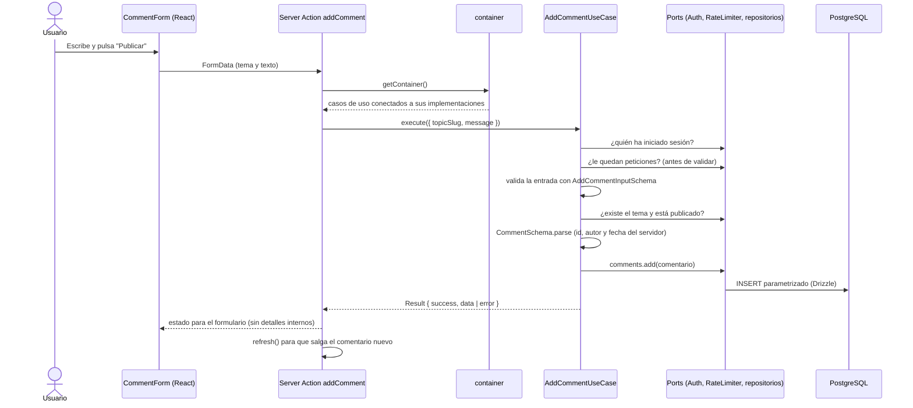
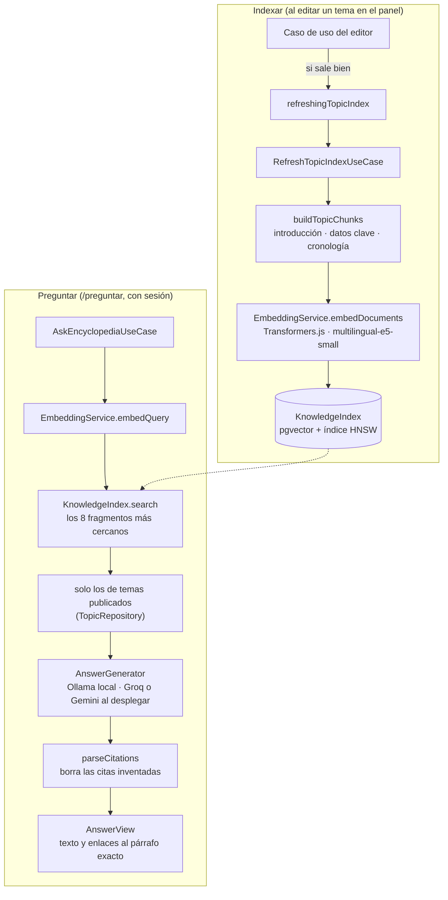

# Guía de arquitectura de MemnonHistory AI

Esta guía sirve para leer el código con orden: por dónde empezar, cómo viaja una petición de la pantalla a la base de datos, cómo funciona el RAG y por qué se tomaron las decisiones principales. La tabla de capas y la regla de dependencias están en el [README](../README.md#4-arquitectura); las normas completas, en [`AGENTS.md`](../AGENTS.md).

Los nombres del código están en inglés y los comentarios en castellano. Cada archivo empieza con una cabecera que dice qué es y por qué existe.

---

## 1. Por dónde empezar a leer

Se recomienda este orden, de dentro hacia fuera:

1. **El dominio**, que tiene las reglas del negocio sin ninguna dependencia:
   - [`HistoricalTopic.ts`](../src/domain/entities/HistoricalTopic.ts): la pieza central. Un tema histórico y lo que necesita para publicarse.
   - [`HistoricalDate.ts`](../src/domain/value-objects/HistoricalDate.ts): las fechas de historia antigua (años negativos, sin año 0, mes opcional).
   - [`KnowledgeChunk.ts`](../src/domain/entities/KnowledgeChunk.ts): cómo se trocea un tema para el RAG.
2. **Un caso de uso sencillo**, con todos los pasos típicos:
   - [`AddCommentUseCase.ts`](../src/application/use-cases/AddCommentUseCase.ts): sesión, límite de peticiones, validación, comprobación de que el tema existe y guardado.
3. **Sus ports**, que son las interfaces que pide al exterior:
   - [`CommentRepository.ts`](../src/application/ports/CommentRepository.ts), [`AuthService.ts`](../src/application/ports/AuthService.ts) y [`RateLimiter.ts`](../src/application/ports/RateLimiter.ts).
4. **Sus dos implementaciones**, la de memoria y la de PostgreSQL:
   - [`InMemoryCommentRepository.ts`](../src/infrastructure/persistence/in-memory/InMemoryCommentRepository.ts) y [`PostgresCommentRepository.ts`](../src/infrastructure/persistence/postgres/PostgresCommentRepository.ts).
5. **La composición**, que une cada caso de uso con sus implementaciones:
   - [`container.ts`](../src/composition/container.ts).
6. **La Server Action y el componente** que lo usan:
   - [`actions.ts`](../src/app/[era]/[category]/[topic]/actions.ts) y [`CommentForm.tsx`](../src/components/topic/CommentForm.tsx).
7. **El RAG completo:**
   - [`AskEncyclopediaUseCase.ts`](../src/application/use-cases/AskEncyclopediaUseCase.ts) y lo que tiene alrededor (sección 3).

---

## 2. El recorrido de una petición: publicar un comentario

Lo que conviene fijarse en este recorrido:

- **La Server Action no tiene lógica.** Es un endpoint POST público: lee el formulario, llama al caso de uso y traduce el `Result` a lo que muestra la interfaz.
- **El caso de uso no confía en nada de la entrada.** La recibe como `unknown` y la valida con un esquema estricto. El autor, el id y la fecha nunca vienen del formulario: salen de la sesión, de `IdGenerator` y de `Clock`.
- **Los errores esperados no son excepciones.** Tema inexistente, entrada no válida o demasiadas peticiones se devuelven como un [`Result`](../src/shared/Result.ts) y la interfaz decide qué mensaje enseña.
- **El caso de uso no sabe qué base de datos hay detrás.** En los tests unitarios recibe repositorios en memoria y en la aplicación, PostgreSQL. Así se prueba toda la lógica sin levantar nada.

Todos los casos de uso que escriben siguen esta misma secuencia. Los del panel la comparten en [`topicEditing.ts`](../src/application/use-cases/topicEditing.ts) y [`authorizeAdmin.ts`](../src/application/use-cases/authorizeAdmin.ts).

---

## 3. El RAG: indexar y preguntar

El RAG tiene dos mitades. **Indexar** ocurre cuando un administrador cambia un tema. **Preguntar** ocurre cuando un usuario escribe una pregunta.

**Indexar.**

- El decorator [`refreshingTopicIndex`](../src/application/use-cases/refreshingTopicIndex.ts) envuelve los casos de uso del panel que cambian lo que se indexa: título, resumen, introducción, datos clave, cronología y estado. Ninguno de ellos sabe que el índice existe.
- [`RefreshTopicIndexUseCase`](../src/application/use-cases/RefreshTopicIndexUseCase.ts) sustituye todos los fragmentos del tema o lo saca del índice si ya no está publicado.
- Si falla, la edición del administrador ya está guardada: el fallo se registra y [`npm run rag:index`](../scripts/rag-index.ts) deja el índice bien.

**Preguntar.**

- [`AskEncyclopediaUseCase`](../src/application/use-cases/AskEncyclopediaUseCase.ts) busca por significado, no por palabras.
- El modelo de lenguaje recibe solo esos fragmentos y debe citar cada frase. El [prompt](../src/infrastructure/ai/answerPrompt.ts) separa las instrucciones de los datos.
- Una respuesta sin citas válidas no se muestra: se enseñan las fuentes encontradas.
- Hay cuatro resultados posibles:
  - respuesta completa;
  - respuesta parcial, que dice qué falta;
  - solo las fuentes, si el modelo no está disponible;
  - sin información, con la opción de proponer un tema.

**Las propuestas de la IA** (cronología y quiz en el panel, rellenar una propuesta desde un fragmento) usan el mismo adaptador de modelo con otros esquemas.

- Nada se guarda solo: el resultado rellena un formulario que revisa una persona.
- Las comprobaciones que no dependen del modelo están en el dominio: [`yearAppearsIn`](../src/domain/entities/TopicDrafts.ts) descarta los años inventados y la rotación de opciones evita que la respuesta correcta salga siempre la primera.

---

## 4. Decisiones principales

| Decisión | Por qué | Dónde |
| --- | --- | --- |
| **Clean Architecture con ports** | La lógica no depende de Next.js, de la base de datos ni del proveedor de IA. Se prueba en memoria y cambiar de proveedor es cambiar un adaptador | [`application/ports/`](../src/application/ports), [`container.ts`](../src/composition/container.ts) |
| **`Result` en lugar de excepciones** | Los fallos esperados forman parte del tipo de retorno: el compilador obliga a tratarlos y la interfaz elige el mensaje | [`Result.ts`](../src/shared/Result.ts) |
| **El dominio como fuente de verdad** | Los esquemas de Zod validan al entrar, al leer de la base de datos y antes de guardar. La base de datos repite las reglas clave con `CHECK` | [`domain/`](../src/domain), [`mappers.ts`](../src/infrastructure/persistence/postgres/mappers.ts), [`schema.ts`](../src/infrastructure/persistence/postgres/schema.ts) |
| **Dos ports para los temas** | La cara pública solo ve temas publicados, y lo filtra en SQL. El editor ve también los borradores. Así un borrador no puede salir en ninguna página por olvido | [`TopicRepository.ts`](../src/application/ports/TopicRepository.ts), [`TopicEditorRepository.ts`](../src/application/ports/TopicEditorRepository.ts) |
| **Listas guardadas enteras y `keepOwnId`** | El editor envía cada lista completa. Un id solo se conserva si ya era de ese tema, así nadie sobrescribe filas de otro tema (BOLA) | [`topicEditing.ts`](../src/application/use-cases/topicEditing.ts) |
| **Slug fijo** | La URL sale del título una vez y no cambia, para que los enlaces y las bibliotecas sigan funcionando | [`CreateTopicUseCase.ts`](../src/application/use-cases/CreateTopicUseCase.ts) |
| **Rol leído en cada petición** | Conceder o retirar el rol de administrador se aplica al momento. El rol solo se cambia con un script en el servidor | [`authorizeAdmin.ts`](../src/application/use-cases/authorizeAdmin.ts), [`admin-role.ts`](../scripts/admin-role.ts) |
| **RAG híbrido y gratuito** | Los embeddings se calculan dentro de Node: sin coste y sin enviar datos fuera. El modelo de lenguaje habla el protocolo de OpenAI: Ollama en local y una API gratuita al desplegar, cambiando solo variables `LLM_*` | [`TransformersEmbeddingService.ts`](../src/infrastructure/ai/TransformersEmbeddingService.ts), [`languageModel.ts`](../src/infrastructure/ai/languageModel.ts) |
| **Salida estructurada y validada** | El modelo devuelve JSON con esquema y la respuesta se valida antes de usarla (OWASP LLM02). Los fallos se registran solo por su tipo (LLM06) | [`languageModel.ts`](../src/infrastructure/ai/languageModel.ts) |
| **Solo contenido revisado en el índice** | Los comentarios y las recomendaciones no se indexan. Un texto sin verificar dentro del prompt es la puerta a la inyección (LLM01) | [`KnowledgeChunk.ts`](../src/domain/entities/KnowledgeChunk.ts) |
| **Catálogo de imágenes en el código** | Desde la web no se sube nada. Cada imagen entra con un commit, con su licencia revisada y su crédito | [`imageCatalog.ts`](../src/infrastructure/images/imageCatalog.ts) |
| **Seed en el código** | Los temas de ejemplo están en Git, se validan con los tests y se cargan en cualquier base de datos con `npm run db:seed` | [`seed/`](../src/infrastructure/persistence/in-memory/seed) |

---

## 5. Cómo se prueba

El proyecto se ha desarrollado con TDD: primero el test que falla y después el código mínimo que lo pasa.

- **Unitarios** ([`tests/`](../tests)): el dominio y los casos de uso, con repositorios en memoria y dobles de IA. No necesitan base de datos, modelo ni red.
- **Tests de contrato** ([`tests/application/ports/`](../tests/application/ports)): cada port tiene un `*.contract.ts`. Lo ejecutan la implementación en memoria y la de PostgreSQL, así las dos se comportan igual y los dobles de los tests unitarios no mienten.
- **Integración**: los repositorios de PostgreSQL y Better Auth contra una base de datos real en Docker.
- **End-to-end** ([`e2e/`](../e2e)): Playwright sobre una compilación de producción. El modelo de lenguaje se sustituye por [`fakeLlmServer.ts`](../e2e/fakeLlmServer.ts), que responde según el nombre del esquema pedido, así los E2E no dependen de Ollama.

---

## 6. Limitaciones conocidas

Se dejan escritas para que no parezcan descuidos:

- **Los límites de peticiones viven en memoria.** Solo valen para un proceso del servidor. Con varias instancias tendrán que pasar a un almacén compartido, como PostgreSQL o Redis.
- **La inyección de prompts no se elimina del todo.** El relleno de propuestas resistió 7 de 8 intentos en las pruebas manuales. Por eso el resultado nunca se guarda solo: lo revisa el usuario y lo aprueba un administrador.
- **El contexto del modelo local es limitado.** `qwen2.5:7b` trabaja con unos 4.000 tokens, y una introducción muy larga se puede quedar corta para pedir propuestas.
- **El primer arranque es lento.** El modelo de embeddings se descarga la primera vez, unos 130 MB, y Ollama tarda en cargar. Por eso el tiempo máximo de respuesta es de 90 segundos.
